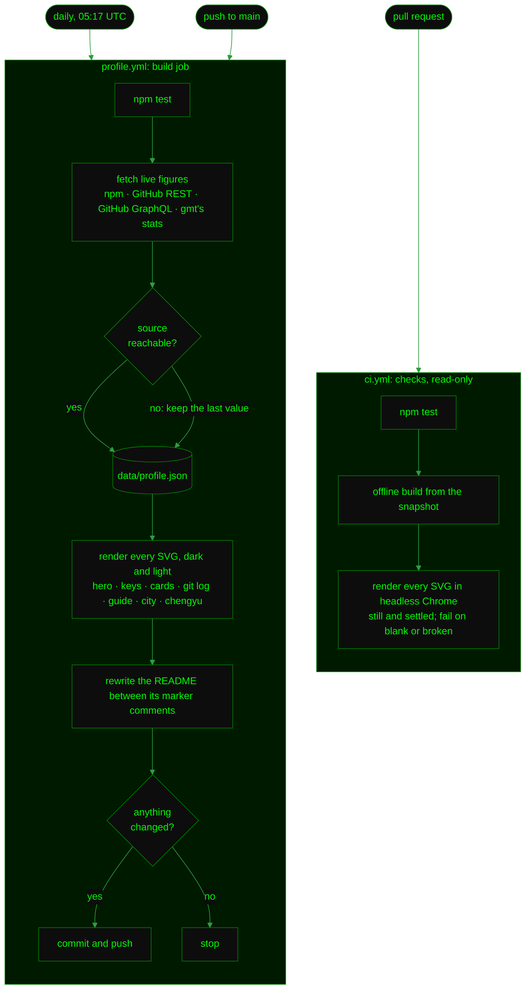

<!--
  Partly generated. Edit anything you like outside the "name:start" / "name:end" marker comments;
  scripts/build-profile.ts rewrites what sits between them (releases, keys, guide), and
  .github/workflows/profile.yml runs it daily. The images in assets/ are generated too: change scripts/,
  not the SVGs. Keep the raven comment below: it's an easter egg for whoever reads the raw file.
-->

<!--
                ░
                ░▓░
                ░▓█▓░
                ░▓███▓
                ▓▓█████▓
               ▓█████████░
               ████████████░
               █████████████▓
               ██████████████
               ██████████████▓
               ███████████████
     ▓▓▓░░     ░██████████████▓▓▓▓▓▓░░
    ▓███████████████████████████████████▓░░
    ▓██████████████████████████████████▓▓▓░░
     ░▓░░            ░░░░░░░░░░░░

    Huginn, "thought": one of Odin's two ravens, sent out each morning to bring back news.
    He crosses the sky on northguild.dev, and a few of the pictures below.

    You read the source, so here is a clue for the field guide at craig-o-curtis.github.io:
    every answer is already on the site. Open a panel, read it, then go back to the guide.
    Start with the language question. The Profile panel answers it in its first lines.
-->

<!-- keys:start -->

  <a href="https://craig-o-curtis.github.io/"><picture><source media="(prefers-color-scheme: dark)" srcset="assets/key-portfolio-dark.svg"></picture></a>
  <a href="https://www.linkedin.com/in/craigocurtis/"><picture><source media="(prefers-color-scheme: dark)" srcset="assets/key-linkedin-dark.svg"></picture></a>
  <a href="https://github.com/northguild"><picture><source media="(prefers-color-scheme: dark)" srcset="assets/key-northguild-dark.svg"></picture></a>
  <a href="https://northguild.dev"><picture><source media="(prefers-color-scheme: dark)" srcset="assets/key-northguild-dev-dark.svg"></picture></a>

<!-- keys:end -->

## Product-Minded, AI-Accelerated Frontend Architect, Fullstack Developer, and Chinese Linguist

I build small, sharp TypeScript tools, mostly things that fix a problem I got tired of having. I build them AI-accelerated: agent-ready APIs, two RAG assistants embedded in my docs sites, and daily Claude Code / Cursor workflows. I build the tooling, not just use it.

Also: I read and speak Chinese. Years of parsing a language with no spaces, no tenses, and heavy context-dependence turns out to be decent training for reading unfamiliar codebases. A chengyu a day, and what it means at a keyboard:

<picture><source media="(prefers-color-scheme: dark)" srcset="assets/idiom-dark.svg"></picture>

<a href="https://northguild.github.io/run-cv/"><picture><source media="(prefers-color-scheme: dark)" srcset="assets/tip-dark.svg"></picture></a>

<code>npx run-cv craig</code> · <a href="https://northguild.github.io/run-cv/">Run it in the browser</a>

## What I'm building at [@northguild](https://github.com/northguild)

Independent open-source engineering. The numbers below are live, refreshed daily.

  <a href="https://northguild.dev/gmt/"><picture><source media="(prefers-color-scheme: dark)" srcset="assets/card-gmt-dark.svg"></picture></a>
  <a href="https://northguild.dev/worktree/"><picture><source media="(prefers-color-scheme: dark)" srcset="assets/card-worktree-dark.svg"></picture></a>

  <a href="https://northguild.dev/gmt/dox/"><picture><source media="(prefers-color-scheme: dark)" srcset="assets/card-dox-dark.svg"></picture></a>
  <a href="https://northguild.dev"><picture><source media="(prefers-color-scheme: dark)" srcset="assets/card-northguild-dark.svg"></picture></a>

<a href="https://github.com/northguild"><picture><source media="(prefers-color-scheme: dark)" srcset="assets/gitlog-dark.svg"></picture></a>

<b>More on each project</b>

 

- **[gmt](https://github.com/northguild/gmt)** — Give Me Temporal! JavaScript's `Date` is a decades-old bug factory: mutable, timezone-naive, and happy to guess what you meant. GMT is the most tested date and time library for JavaScript and TypeScript: built on the TC39 Temporal standard, it never touches `Date`, and its typed string-in / string-out functions handle time zones, DST, and business days in place of Luxon, date-fns, Moment.js, and Day.js. Ships with companion lint packages (`@northguild/gmt-oxlint`, `@northguild/gmt-eslint`, `@northguild/gmt-biome`) that keep humans and AI agents off the legacy footguns. pnpm monorepo, published as `@northguild/gmt`. [Docs](https://northguild.dev/gmt/) · [Dox](https://northguild.dev/gmt/dox/), the docs assistant that runs GMT's tools and answers from the API reference
- **[worktree](https://github.com/northguild/worktree)** — Git worktrees are excellent and the raw commands are awkward. This CLI turns branch-off → create → copy `.env` → open editor → clean up later into a few commands with sensible prompts, and can hand the new worktree straight to a coding agent. A `--json` agent mode and an installable agent skill let agents drive it too, and the docs have an embedded AI assistant. Context switching without the stash-and-pray dance. `npx @northguild/worktree` · [Docs](https://northguild.dev/worktree/)

### Latest releases

<!-- releases:start -->
| Project | Latest release | Date | Releases, last 90 days |
| --- | --- | --- | ---: |
| [gmt](https://github.com/northguild/gmt) | [`@northguild/gmt@1.21.0`](https://github.com/northguild/gmt/releases/tag/%40northguild/gmt%401.21.0) | 2026-11-03 | 8 |
| [worktree](https://github.com/northguild/worktree) | [`v3.0.0`](https://github.com/northguild/worktree/releases/tag/v3.0.0) | 2026-11-07 | 14 |
<!-- releases:end -->

### Pop quiz

Where I'm from, under purple rain.

<!-- guide:start -->
<picture><source media="(prefers-color-scheme: dark)" srcset="assets/guide-dark.svg"></picture>

  <a href="#pop-quiz"><picture><source media="(prefers-color-scheme: dark)" srcset="assets/answer-a-dark.svg"></picture></a>
  <a href="#pop-quiz"><picture><source media="(prefers-color-scheme: dark)" srcset="assets/answer-b-dark.svg"></picture></a>
   
  <a href="#pop-quiz"><picture><source media="(prefers-color-scheme: dark)" srcset="assets/answer-c-dark.svg"></picture></a>
  <a href="#pop-quiz"><picture><source media="(prefers-color-scheme: dark)" srcset="assets/answer-d-dark.svg"></picture></a>

<b>Answer</b>

 

**Minneapolis.** Prince’s hometown, and mine. The purple rain falling on the skyline above is for him.

<!-- guide:end -->

### Contributions

<a href="https://github.com/craig-o-curtis"><picture><source media="(prefers-color-scheme: dark)" srcset="assets/city-dark.svg"></picture></a>

<a href="https://craig-o-curtis.github.io/"><picture><source media="(prefers-color-scheme: dark)" srcset="assets/portfolio-dark.svg"></picture></a>

<a href="https://craig-o-curtis.github.io/"><b>craig-o-curtis.github.io</b></a>

---

<b>How this README builds itself</b>

 

No dependencies: Node 24 runs the TypeScript in [scripts/](scripts/) directly, and every image is a hand-built SVG.

<b>A note on this account</b>

 

Most of my production work over the last decade lived in organizations I no longer have access to. What's left under my personal account is largely a decade of learning exercises and course demos — I've kept them public because the trail is worth more than a tidy profile. The open-source I own and actively maintain is under [@northguild](https://github.com/northguild), pinned below.

